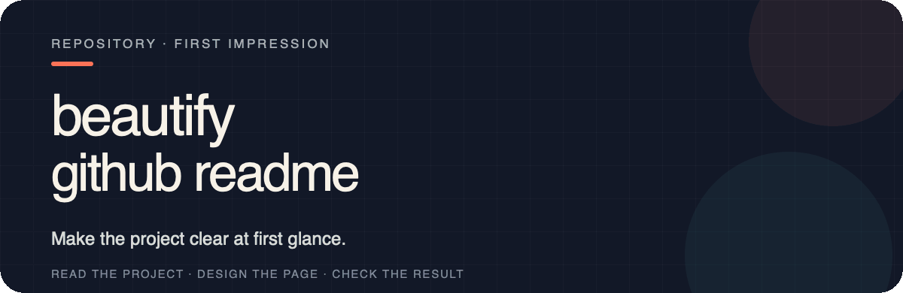
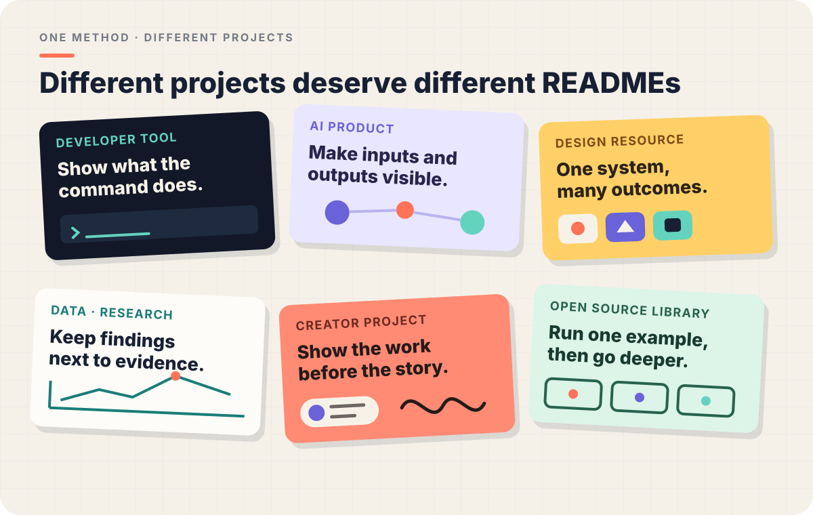
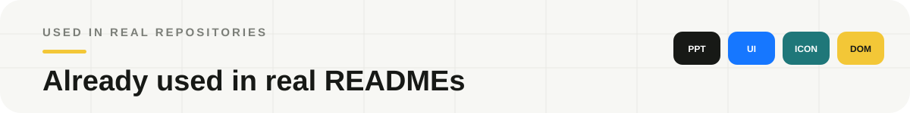
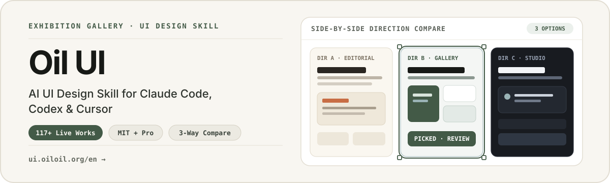
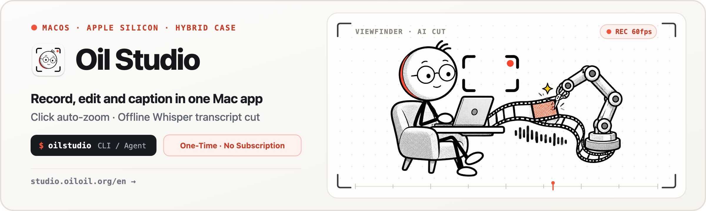
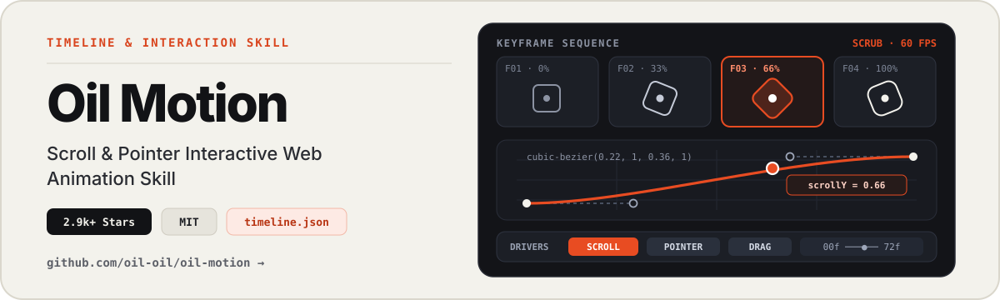
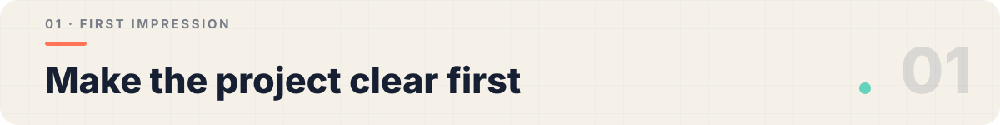
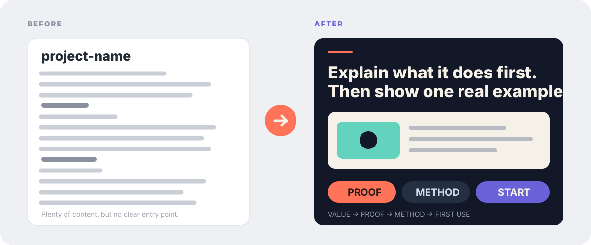
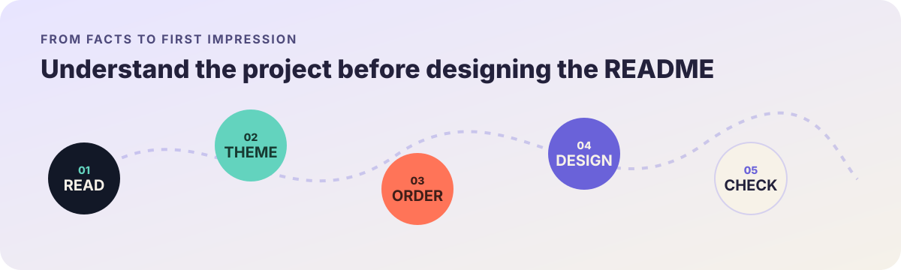

<p align="right">
  <strong>English</strong> · <a href="./README.zh-CN.md">简体中文（含 Oil Book / Oil UI / Oil Studio 实战案例）</a> · <a href="./README.ja.md">日本語</a>
</p>

<p align="center">
  
</p>

<p align="center">
  
</p>

<p align="center">
  
</p>

These are not hypothetical templates. The flagship products and open-source tools below use this method while keeping their own visual language and structure:

- **[Oil UI](https://ui.oiloil.org/en/?utm_source=github&utm_medium=readme&utm_campaign=beautify-github-readme)** — an AI UI design Skill for Claude Code, Codex, and Cursor with 3-direction side-by-side comparison, 117+ live works, and MIT + Pro editions.
- **[Oil Studio](https://studio.oiloil.org/en/?utm_source=github&utm_medium=readme&utm_campaign=beautify-github-readme)** — a native Apple Silicon screen recorder with automatic click zoom, offline Whisper transcript-based cutting, and one-time purchase with no subscription.
- **[Oil Motion](https://github.com/oil-oil/oil-motion)** — a scroll- and pointer-driven interactive web animation Skill (`2.9k+` stars, MIT) built around compiled timelines and keyframe sequences.
- **[oil-ppt](https://github.com/oil-oil/oil-ppt)** — presents the method, results, and first-use path for programmatic slide creation in one visual system.
- **[Selector](https://github.com/oil-oil/selector)** — puts page selection, structured context, and real output directly into the opening screen and examples.

Explore more real-world examples from the community in **[SHOWCASE.md](./SHOWCASE.md)**. Want to share your public README? Open a PR to **`SHOWCASE.md` only** (please do not modify `README.md`, `README.zh-CN.md`, or `README.ja.md`).

Below are three independent product hero directions. None of them share a template; each derives its palette, typography, and proof directly from the product itself:

<p align="center">
  <a href="https://ui.oiloil.org/en/?utm_source=github&utm_medium=readme&utm_campaign=beautify-github-readme">
    
  </a>
</p>

**[Oil UI](https://ui.oiloil.org/en/?utm_source=github&utm_medium=readme&utm_campaign=beautify-github-readme)** uses a quiet exhibition-gallery palette and an architectural 3-column comparison board with selection handles to make side-by-side UI exploration legible at a glance.

<p align="center">
  <a href="https://studio.oiloil.org/en/?utm_source=github&utm_medium=readme&utm_campaign=beautify-github-readme">
    
  </a>
</p>

**[Oil Studio](https://studio.oiloil.org/en/?utm_source=github&utm_medium=readme&utm_campaign=beautify-github-readme)** demonstrates a real hybrid SVG workflow: deterministic SVG controls the real Mac app icon lockup, typography, pills, and viewfinder chrome, while a transparent AI-generated manga-ink illustration brings the brand character and filmstrip-editing arm to life.

<p align="center">
  <a href="https://github.com/oil-oil/oil-motion">
    
  </a>
</p>

**[Oil Motion](https://github.com/oil-oil/oil-motion)** pairs crisp editorial typography with a dark kinetic timeline stage—combining a 4-frame sequence strip, cubic-bezier easing handles, and scroll/pointer driver indicators.

<p align="center">
  
</p>

Most repositories already contain enough information. The problem is usually the order: visitors see internal terminology, installation commands, and directory trees before they understand what the project is for.

`beautify-github-readme` reads the real repository first, identifies the clearest value and proof, and only then decides how the page should look.

<p align="center">
  
</p>

In whole-README mode, it works across three layers:

| Content | Visual system | Engineering |
| --- | --- | --- |
| Remove repetition, move proof forward, and replace internal jargon with concrete outcomes | Derive color, typography, composition, and project-native motifs before designing the hero and supporting modules | Keep assets GitHub-safe, images accessible, commands copyable, and body text searchable |

Different projects should not receive the same template. A CLI can use command rhythm and cursors; an icon system can use keylines and cutouts; a research repository can use coordinates, charts, and evidence labels.

<p align="center">
  
</p>

GitHub READMEs do not have the layout freedom of a website. This Skill separates the visual and content layers:

- SVG handles editable heroes, section transitions, comparisons, diagrams, and identity.
- Hybrid SVG composition combines deterministic SVG layout with optional AI-generated, background-removed subjects for characters, organic texture, complex materials, and cinematic lighting.
- GIF handles approved motion while the static SVG remains the editable fallback.
- Motion is opt-in and is never generated by default.
- PNG/WebP handles screenshots, generated artwork, and complex showcase walls.
- Markdown handles explanations, commands, links, configuration, and contribution details.

The result can feel designed without becoming one long image that nobody can search, copy, or maintain.

The reusable production guidance lives here:

- [Designing a project-native hero](./skills/beautify-github-readme/references/project-native-hero.md)
- [Writing GitHub-safe README SVGs](./skills/beautify-github-readme/references/svg-production.md)
- [Composing SVG with generated raster material](./skills/beautify-github-readme/references/hybrid-svg-production.md)
- [Producing GitHub-safe README motion](./skills/beautify-github-readme/references/motion-production.md)

<p align="center">
  
</p>

The process keeps four promises: use real project material, never invent capabilities, keep private files and data out of what gets published, and never publish without explicit approval.

<p align="center">
  
</p>

**Option 1 · Install from the command line**

```bash
npx skills add oil-oil/beautify-github-readme
```

**Option 2 · Ask your Agent to install it**

```text
Install this Skill: https://github.com/oil-oil/beautify-github-readme
```

The Skill has two explicit modes:

| Mode | What it changes | What it leaves alone by default |
| --- | --- | --- |
| Whole README | Reading order, copy hierarchy, proof, Markdown, and the complete visual system | It will not commit, push, or publish without approval |
| Asset-only | A static SVG hero, section headers, workflow, badge, diagram, or an optional GitHub-safe GIF with SVG source | It will not edit README copy, order, image references, or links |

If the request already states the scope, the Skill starts directly. If a user only says “beautify this repository” or provides a repository URL, the Agent asks:

```text
Would you like me to improve the whole README or only create visual assets?
If asset-only, do you need a hero, section headers, workflow, badge, motion graphic, or a coordinated set?
```

**Whole-README mode**

```text
Use $beautify-github-readme to redesign this repository homepage around its real project theme.
Show me a local preview first and do not push anything.
```

**Asset-only mode**

```text
Use $beautify-github-readme to keep the README unchanged and create one animated GIF hero with its SVG source.
Derive the style from the existing project and show me the rendered preview first.
```

Reading a README for context does not grant permission to edit it. In asset-only mode, embedding the new assets requires a separate, explicit approval.

You can also request a read-only audit:

```text
Use $beautify-github-readme to audit this README for clarity, hierarchy, trust, and maintenance cost. Do not edit files.
```

Whole-README mode delivers a local preview, visual assets, and a README diff. Asset-only mode delivers source assets, rendered previews, optional GIF derivatives, and embed snippets. Commits, pushes, PRs, and publishing always require explicit authorization.

<p align="center">
  <a href="https://github.com/oil-oil/oil-ui"></a>
  <br>
  <strong><a href="https://github.com/oil-oil/oil-ui">Want better UI designs from AI? Try oil-ui →</a></strong><br>Explore distinct styles, compare them side by side, and refine the rendered result.
</p>

<p align="center">
  <a href="https://x.com/I_am_oil_oil"></a>
</p>

MIT License

---

This README is also a working example: it combines a project-native hero, a theme wall, real adoption proof, section transitions, and readable Markdown instead of rasterizing the whole page.

## 配置、依赖与使用边界

Markdown/SVG 本身无需账号或 API Key；生成 PNG/WebP 或采用 AI 生图时需要对应渲染与已授权生成工具。

不伪造 star、性能、用户或品牌背书；本机路径、私有项目内容、原始日志和测试数据默认不进 README 和公开文件；修改后检查链接、素材与实际渲染。发布与合并遵守当前任务授权。

使用示例：

```text
优化这个仓库的 README 首页，保留真实项目事实。
```
