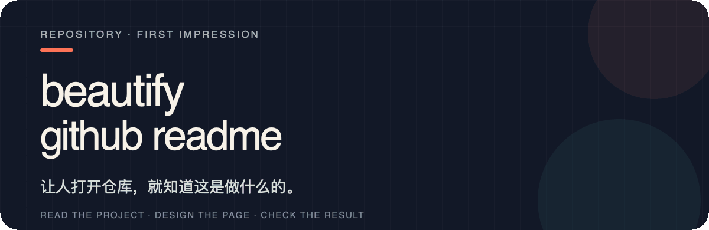
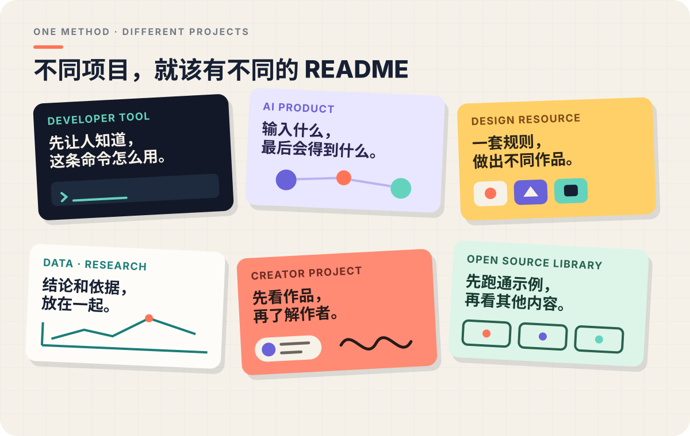
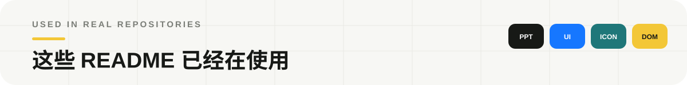
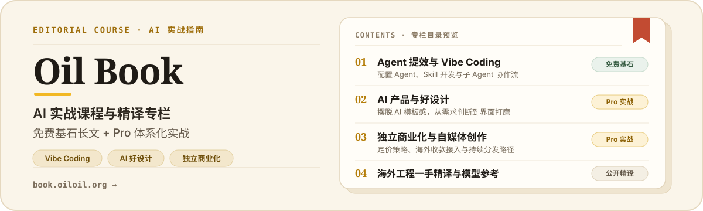
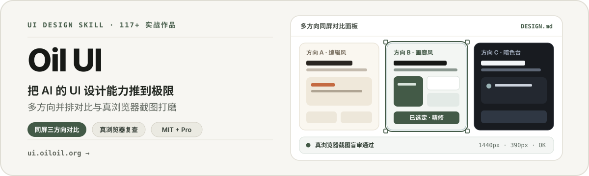
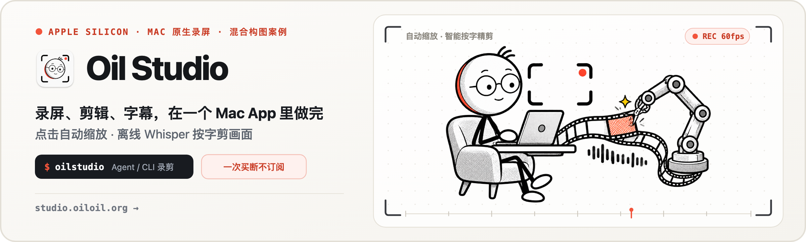
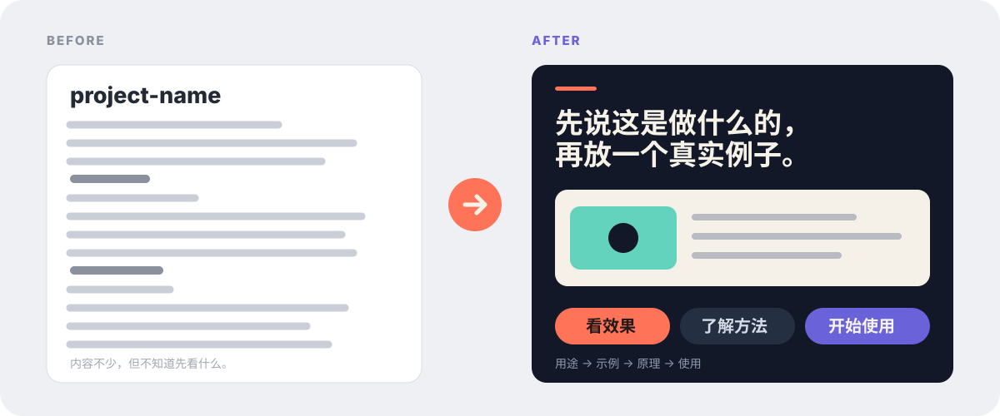
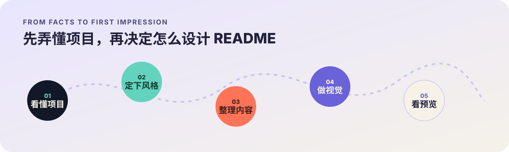

<p align="right">
  <a href="./README.md">English</a> · <strong>简体中文</strong> · <a href="./README.ja.md">日本語</a>
</p>

<p align="center">
  
</p>

<p align="center">
  
</p>

<p align="center">
  
</p>

这不是一组假想模板。下面五个主力产品与开源仓库都采用这套方法构建视觉与内容结构，各自保留独立的产品语言：

- **[Oil Book](https://book.oiloil.org/?utm_source=github&utm_medium=readme&utm_campaign=beautify-github-readme)** · AI 实战课程与精译专栏，用免费基石长文与 Pro 体系化实战讲透 Vibe Coding、AI 设计与独立商业化。
- **[Oil UI](https://ui.oiloil.org/?utm_source=github&utm_medium=readme&utm_campaign=beautify-github-readme)** · 开源 UI 设计 Skill（MIT + Pro），支持同屏多方向并排对比、117+ 实战作品画廊与真浏览器截图打磨。
- **[Oil Studio](https://studio.oiloil.org/?utm_source=github&utm_medium=readme&utm_campaign=beautify-github-readme)** · Apple Silicon Mac 原生自动缩放录屏与剪辑工具，支持离线 Whisper 按字剪画面与一次买断不订阅。
- **[oil-ppt](https://github.com/oil-oil/oil-ppt)** · 把程序化 PPT 的方法、效果和使用路径放在同一套视觉系统里。
- **[Selector](https://github.com/oil-oil/selector)** · 把网页选取、结构化上下文和实际输出直接放进首屏与示例。

更多社区真实案例统一收录在 **[SHOWCASE.md](./SHOWCASE.md)**。如果这个 Skill 帮你做出了一份愿意公开分享的 README，欢迎**仅向 `SHOWCASE.md` 提 PR**（请勿修改首页 `README*.md`）。

下面是三个完全不同风格的产品展示案例。它们不共用同一套模板，而是直接根据产品气质决定配色、排版和右侧证据模块：

<p align="center">
  <a href="https://book.oiloil.org/?utm_source=github&utm_medium=readme&utm_campaign=beautify-github-readme">
    
  </a>
</p>

**[Oil Book](https://book.oiloil.org/?utm_source=github&utm_medium=readme&utm_campaign=beautify-github-readme)** 采用暖纸出版物配色、衬线标题与书签目录卡片，直接呈现免费基石长文与 Pro 实战专栏的阅读结构。

<p align="center">
  <a href="https://ui.oiloil.org/?utm_source=github&utm_medium=readme&utm_campaign=beautify-github-readme">
    
  </a>
</p>

**[Oil UI](https://ui.oiloil.org/?utm_source=github&utm_medium=readme&utm_campaign=beautify-github-readme)** 用克制的画廊暖白底与三方向并排对比视窗，直观展示从多风格探索到真浏览器截图复查的完整设计流程。

<p align="center">
  <a href="https://studio.oiloil.org/?utm_source=github&utm_medium=readme&utm_campaign=beautify-github-readme">
    
  </a>
</p>

**[Oil Studio](https://studio.oiloil.org/?utm_source=github&utm_medium=readme&utm_campaign=beautify-github-readme)** 是一个真实的混合式 SVG 构图案例：SVG 精确控制真实应用图标组合、中文排版、功能胶囊与取景框结构，右侧合成 AI 生成的透明底漫画墨线小人录屏与机械臂剪胶片插画。

<p align="center">
  
</p>

很多仓库的信息其实已经够了，只是没有排好顺序。访客一上来看到内部术语、安装命令和目录结构，却还不知道这个项目是做什么的。

`beautify-github-readme` 会先把项目看懂，再决定什么应该放在前面、什么可以往后放。我们先把项目说清楚，再去做视觉。

<p align="center">
  
</p>

在整份 README 模式里，它会同时处理三件事：

| 内容 | 视觉 | 工程 |
| --- | --- | --- |
| 删除重复表述，效果前置，把术语换成更好懂的话 | 从项目本身找到配色、字体和图形语言，再设计 SVG 首屏与展示图 | 保持 GitHub 兼容、图片可访问、命令可复制、正文可搜索 |

不同项目不会得到同一张模板。终端工具可以使用命令节奏与光标，图标系统可以使用网格与切片，研究项目可以使用坐标、图表和证据标签。

<p align="center">
  
</p>

GitHub README 不能像网站一样自由使用 CSS。这个 Skill 把视觉层做成响应式 SVG，把真正需要阅读、复制和维护的内容留在 Markdown：

- SVG 负责可编辑的首屏、章节、比较、流程和品牌感。
- 混合式 SVG 构图把确定性的 SVG 排版，与可选的 AI 生图和抠图素材结合，适合人物、有机质感、复杂材质和电影感光影。
- GIF 负责经过确认的动效，同时保留静态 SVG 作为可编辑源文件和降级版本。
- 动效必须由用户主动选择，不会默认生成。
- PNG/WebP 负责截图、生成图片和复杂作品墙。
- Markdown 负责解释、命令、链接、配置和贡献说明。

这样做，页面可以有完整的设计，也不会变成一张不能搜索、不能维护的长图。

具体怎么从项目内容设计标题、怎么写这些 SVG，已经整理成两份可以直接照着执行的规范：

- [怎么从项目内容设计标题](./skills/beautify-github-readme/references/project-native-hero.md)
- [README SVG 的写法](./skills/beautify-github-readme/references/svg-production.md)
- [SVG 与 AI 生图的混合式构图](./skills/beautify-github-readme/references/hybrid-svg-production.md)
- [README 动效的制作方法](./skills/beautify-github-readme/references/motion-production.md)

<p align="center">
  
</p>

整个过程只守四件事：使用真实内容、不编造产品能力、私人文件和数据不进公开内容、没有确认就不推送。

<p align="center">
  
</p>

**方式一 · 执行命令**

```bash
npx skills add oil-oil/beautify-github-readme
```

**方式二 · 直接交给 Agent**

把下面这句话发给 Agent：

```text
请安装这个 Skill：https://github.com/oil-oil/beautify-github-readme
```

安装之后，有两种明确的使用方式：

| 模式 | 会做什么 | 默认不会做什么 |
| --- | --- | --- |
| 整份 README 优化 | 重组阅读顺序、精简文案、整理真实证据，并建立完整视觉系统 | 未经确认不会提交、推送或发布 |
| 只生成视觉素材 | 生成静态 SVG 首图、章节标题、流程图、徽章，或保留 SVG 源文件的 GitHub-safe GIF | 不改 README 正文、顺序、图片引用或链接 |

如果请求已经说明范围，Skill 会直接执行。只说“美化这个仓库”或只提供仓库地址时，Agent 会先问：

```text
这次希望我优化整份 README，还是只生成视觉素材？
如果只做素材，请告诉我是首图、章节标题、流程图、徽章、动效，还是一组视觉模块。
```

**整份 README 优化**

```text
[$beautify-github-readme] 帮我重新设计这个仓库的 GitHub 主页，
风格根据项目主题决定。先给我本地预览，不要推送。
```

**只生成视觉素材**

```text
[$beautify-github-readme] 保留 README 不动，生成一张动态 GIF 首图，并保留 SVG 源文件。
根据项目现有风格设计，先给我渲染预览。
```

只生成视觉素材的模式下，即使 Agent 为了理解项目读取了 README，也不代表可以修改它。需要把新素材嵌入 README 时，会再次取得明确授权。

也可以只做只读审查：

```text
[$beautify-github-readme] 只审查这个 README，告诉我哪里难懂，不要修改文件。
```

整份 README 模式默认交付本地预览、视觉素材和 README diff；只生成视觉素材的模式默认交付源文件、渲染预览、可选 GIF 和嵌入代码。只有在明确授权后，才会修改引用、提交、推送或创建 PR。

想继续了解平时怎么写好一个 Skill，或者怎么把开源项目和付费产品结合起来做，可以看 Oil Book 里的[《如何从 0 到 1 写一个好用的 Skill》](https://book.oiloil.org/articles/skill-dev-guide?utm_source=github&utm_medium=referral&utm_campaign=beautify-readme)和[《如何做一个商业化的付费 Skill》](https://book.oiloil.org/articles/commercial-paid-skill?utm_source=github&utm_medium=referral&utm_campaign=beautify-readme)。

<p align="center">
  <a href="https://github.com/oil-oil/oil-ui"></a>
  <br>
  <strong><a href="https://github.com/oil-oil/oil-ui">想让 AI 做出更好的 UI 设计？试试 oil-ui →</a></strong><br>先探索几种风格，再并排挑选，按实际画面打磨。
</p>

<p align="center">
  <a href="https://x.com/I_am_oil_oil"></a>
</p>

MIT License

---

这份 README 也是一个实际示例。我们在同一页里用了深色首屏、多主题展示、前后对比、流程图和三种章节容器，同时把需要复制和阅读的内容留在 Markdown 里。
